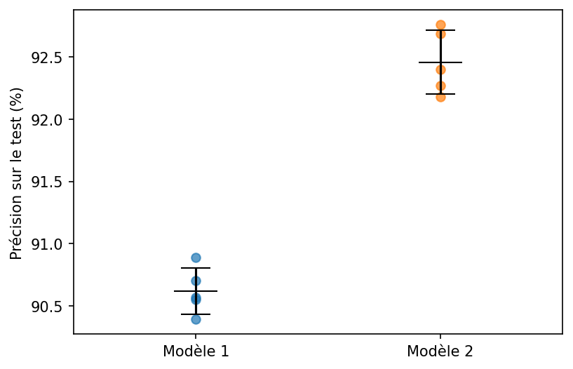
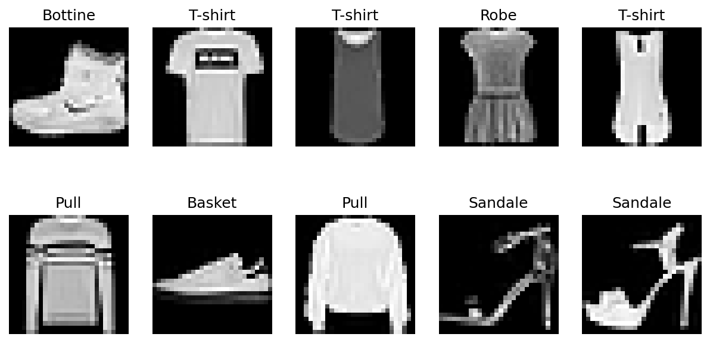
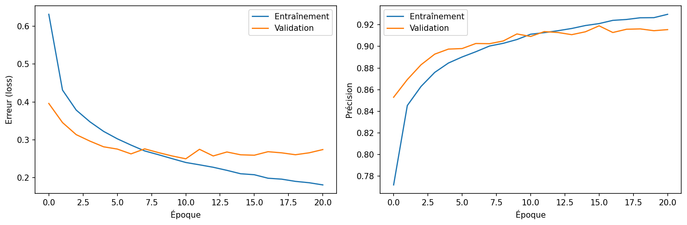
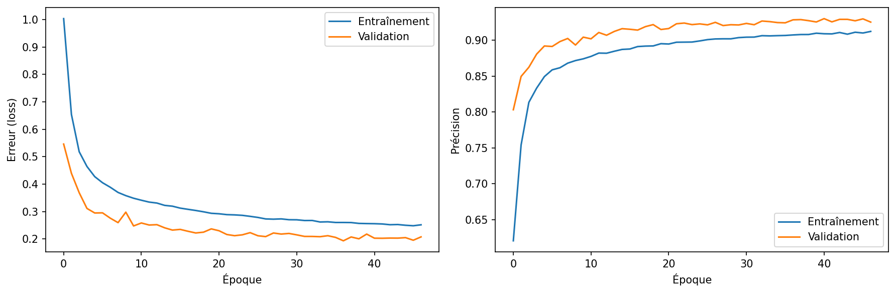
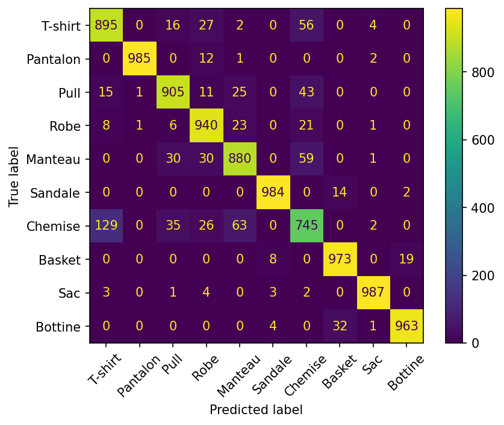
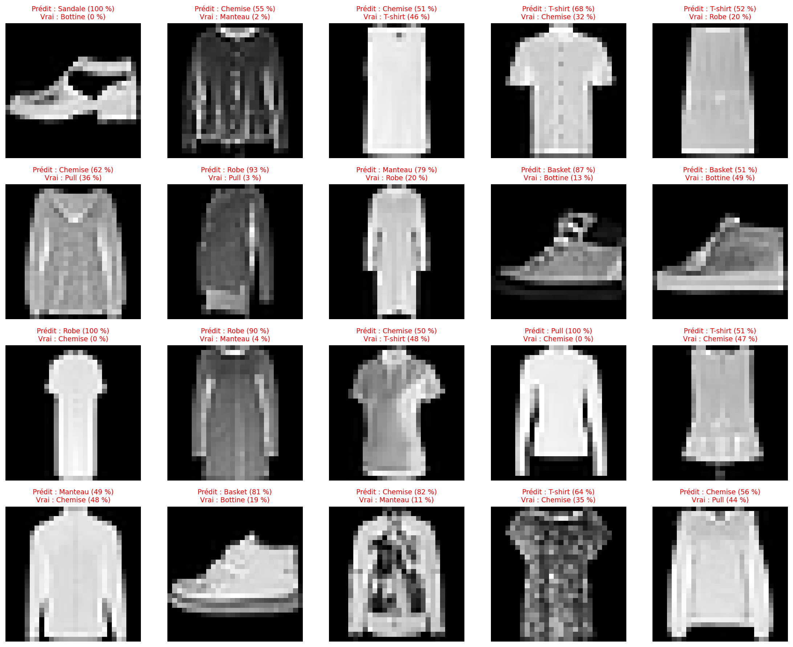

# Classification de vêtements avec un CNN (Fashion-MNIST)

[](https://colab.research.google.com/github/mamalo35/Classification_de_vetements_avec_un_CNN_Fashion_MNIST/blob/main/notebooks/fashion_mnist_cnn.ipynb)
[](https://www.kaggle.com/code/malovaillant/fashion_mnist_cnn)

Réseau de neurones convolutif (CNN) qui reconnaît le type de vêtement sur une image, parmi 10 catégories.
Le modèle final atteint **92,5 % ± 0,3 de précision** sur le jeu de test (moyenne sur 5 entraînements), contre 90,6 % ± 0,2 pour un CNN de base.

## Résultats clés

| | Modèle 1 : CNN de base | Modèle 2 : CNN amélioré |
|---|---|---|
| Précision test (moyenne sur 5 entraînements) | 90,6 % ± 0,2 | **92,5 % ± 0,3** |
| Paramètres | 121 930 | 468 202 |
| Surapprentissage | Oui, dès ~10 époques | Non |

- Les 5 entraînements du modèle 2 dépassent tous ceux du modèle 1 : l'écart (1,8 point) est environ 7 fois plus grand que la variabilité d'un entraînement à l'autre.
- Quand le modèle 2 se trompe, la bonne réponse fait presque toujours partie de ses deux premiers choix (précision top-2 : 98,4 %).
- En ne traitant automatiquement que les images où il est sûr à plus de 80 %, il couvre 87 % des images avec 97,0 % de précision.



## Données

Le projet utilise **[Fashion-MNIST](https://github.com/zalandoresearch/fashion-mnist)**, publié par Zalando Research : 70 000 images de vêtements en niveaux de gris de 28 × 28 pixels, réparties en 10 classes équilibrées.

| Étiquette | Classe | Étiquette | Classe |
|---|---|---|---|
| 0 | T-shirt | 5 | Sandale |
| 1 | Pantalon | 6 | Chemise |
| 2 | Pull | 7 | Basket |
| 3 | Robe | 8 | Sac |
| 4 | Manteau | 9 | Bottine |



**Préparation** : normalisation des pixels entre 0 et 1 (division par 255), et ajout d'une dimension « canal » `(28, 28)` → `(28, 28, 1)` pour les couches `Conv2D`.

## Méthode

- **Trois jeux de données séparés** : 54 000 images pour l'entraînement, 6 000 pour la validation (suivi de l'entraînement et choix des réglages), et 10 000 images de test utilisées uniquement pour l'évaluation finale.
- **Mêmes conditions pour les deux modèles** : optimiseur Adam, jusqu'à 100 époques, `EarlyStopping` avec une patience de 10 qui conserve la meilleure version du modèle. L'écart entre les modèles vient donc de leur architecture, pas du temps d'entraînement.
- **Comparaison sur plusieurs entraînements** : sur GPU, les résultats varient légèrement d'une exécution à l'autre, même avec une graine fixée. Chaque modèle a donc été entraîné 5 fois avec des graines différentes, et la comparaison porte sur la moyenne et l'écart-type.

## Les modèles

### Modèle 1 : CNN de base

| Couche | Sortie |
|---|---|
| Entrée | 28 × 28 × 1 |
| Conv2D (32 filtres 3×3, ReLU) | 26 × 26 × 32 |
| MaxPooling 2×2 | 13 × 13 × 32 |
| Conv2D (64 filtres 3×3, ReLU) | 11 × 11 × 64 |
| MaxPooling 2×2 | 5 × 5 × 64 |
| Flatten | 1 600 |
| Dense (64, ReLU) + Dropout 0,5 | 64 |
| Dense (10, softmax) | 10 |

Ce modèle surapprend rapidement : après une dizaine d'époques, son erreur d'entraînement continue de baisser alors que son erreur de validation remonte.



### Modèle 2 : CNN amélioré

| Bloc | Couches |
|---|---|
| Augmentation | RandomFlip (horizontal), RandomTranslation (10 %) |
| Bloc 1 | Conv2D 32 → BatchNormalization → Conv2D 32 → MaxPooling → Dropout 0,25 |
| Bloc 2 | Conv2D 64 → BatchNormalization → Conv2D 64 → MaxPooling → Dropout 0,25 |
| Décision | Flatten → Dense 128 → Dropout 0,5 → Dense 10 (softmax) |

| Changement | Pourquoi |
|---|---|
| Augmentation de données | Le modèle voit des images légèrement modifiées et apprend des caractéristiques plus robustes |
| Deux `Conv2D` par bloc, `padding="same"` | Repérer des détails fins (col, boutons) avant que le pooling ne réduise l'image |
| `BatchNormalization` | Un apprentissage plus stable |
| `Dropout` après chaque bloc | Limiter le surapprentissage |

Grâce à cette régularisation, le modèle 2 ne surapprend pas : sa précision d'entraînement reste inférieure à celle de validation, et il continue de progresser bien plus longtemps.



## Analyse par classe

Résultats d'un entraînement représentatif (modèle 1 : 90,30 %, modèle 2 : 92,57 %).

| Classe | Modèle 1 | Modèle 2 |
|---|---|---|
| Chemise | 65,4 % | **74,5 %** |
| Manteau | 83,1 % | 88,0 % |
| Pull | 86,4 % | 90,5 % |
| T-shirt | 89,1 % | 89,5 % |
| Robe | 92,1 % | 94,0 % |
| Bottine | 94,5 % | 96,3 % |
| Basket | 98,1 % | 97,3 % |
| Pantalon | 97,7 % | 98,5 % |
| Sac | 97,9 % | 98,7 % |
| Sandale | 98,7 % | 98,4 % |

- Le gain le plus net concerne les hauts (chemise, manteau, pull), dont les confusions mutuelles diminuent fortement.
- **La chemise reste la classe la plus difficile** : elle est surtout confondue avec le T-shirt, le pull et le manteau. À 28 × 28 pixels, le col et les boutons qui les distinguent sont souvent invisibles.
- Ces résultats par classe varient sensiblement d'un entraînement à l'autre : seul le gain global est confirmé sur plusieurs exécutions.



## Analyse des erreurs



- **Des hésitations plutôt que des erreurs absurdes** : sur 743 erreurs, 586 (près de 8 sur 10) sont des cas où la bonne réponse était le deuxième choix du modèle. Une partie des erreurs restantes concerne des images ambiguës ou à l'étiquette discutable.
- **Une confiance fiable** : plus le modèle est sûr de lui, plus il a raison. Il peut donc s'abstenir sur les images douteuses et les confier à un humain.

| Seuil de confiance | Images traitées automatiquement | Précision sur ces images |
|---|---|---|
| 50 % | 98,2 % | 93,5 % |
| 70 % | 90,9 % | 96,0 % |
| 80 % | 86,9 % | 97,0 % |
| 90 % | 81,3 % | 98,4 % |
| 99 % | 66,4 % | 99,5 % |

Avec un seuil de 80 %, en confiant 13 % des images à un humain, on écarte environ les deux tiers des erreurs.

## Limites et pistes d'amélioration

**Limites**
- Les scores varient légèrement d'une exécution à l'autre sur GPU ; avec 5 entraînements, ils restent approximatifs à quelques dixièmes de point près.
- Tous les scores sont mesurés sur les mêmes 10 000 images de test.
- Le gain du modèle 2 a un coût : environ 4 fois plus de paramètres, et chaque époque prend environ 3 fois plus de temps.

**Pistes**
- Un troisième bloc convolutif ou plus de filtres, pour mieux distinguer les hauts.
- Un réentraînement final sur les 60 000 images d'entraînement.

## Structure du dépôt

```
fashion-mnist-cnn/
├── README.md
├── requirements.txt
├── notebooks/
│   └── fashion_mnist_cnn.ipynb   # notebook complet, exécuté
├── images/                       # graphiques produits par le notebook
└── models/
    └── cnn_v2.keras              # modèle 2 entraîné
```

## Reproduire les résultats

- **En un clic** : ouvrir le notebook avec le badge Colab ou Kaggle en haut de cette page, activer un GPU, puis tout exécuter. Compter environ 2 heures avec la comparaison sur 5 entraînements.
- **En local** :
  ```bash
  pip install -r requirements.txt
  jupyter notebook notebooks/fashion_mnist_cnn.ipynb
  ```

Pour utiliser le modèle entraîné sans réentraîner :
```python
import keras
model = keras.models.load_model("models/cnn_v2.keras")
```

## Technologies

Python · Keras (backend TensorFlow) · NumPy · pandas · Matplotlib · scikit-learn · Kaggle (entraînement sur GPU)
